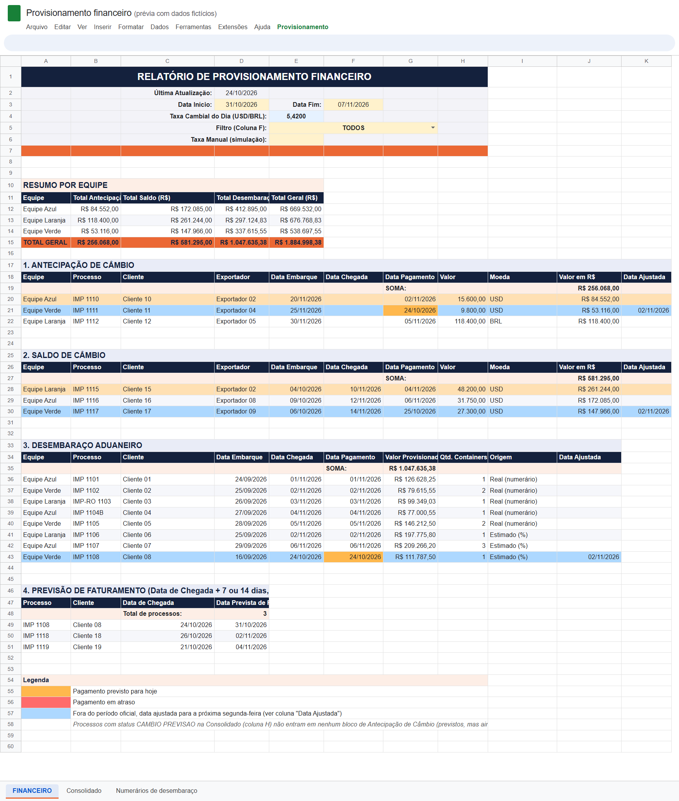

# Provisionamento financeiro de importação

[](https://github.com/karencecilia04-max/provisionamento-financeiro-importacao/actions/workflows/testes.yml)  

Fluxo financeiro semanal de importação no Google Sheets, com extração automática dos numerários de desembaraço em PDF.



## Problema

Semanalmente, os analistas de importação precisavam informar ao setor financeiro todos os desembolsos previstos para a semana seguinte. O levantamento era manual, feito a partir do follow-up de cada equipe e dos numerários enviados pelos despachantes.

## Lógica

```
PDF do despachante -> robô de numerários -> aba "Numerários de desembaraço" --+
                                                                              +--> relatório FINANCEIRO
follow-up das equipes (aba Consolidado) --------------------------------------+
```

- **Consolidação a partir do follow-up.** A planilha extrai os dados do controle de cada equipe e separa os desembolsos por categoria: câmbios a pagar (antecipações e saldos) e desembaraço aduaneiro.
- **Período e câmbio configuráveis.** O usuário define o período, e a conversão de moeda utiliza a taxa do dia (Google Finance) ou uma taxa informada manualmente para simulação.
- **Valor real sempre que disponível.** Um robô em Python monitora a pasta de numerários a cada 15 minutos, lê os PDFs novos, identifica a referência do processo e o valor total e atualiza a planilha automaticamente. Enquanto o numerário não chega, a planilha utiliza uma estimativa.
- **Nenhum valor presumido.** Quando o robô não reconhece o total ou a referência, o registro é marcado como erro e a estimativa é mantida até a conferência.
- **Saída pronta para o financeiro.** O relatório é atualizado sob demanda e pode ser exportado em Excel.

> Todos os dados deste repositório são fictícios.

## Tecnologias

Google Apps Script, Python, pdfplumber, Google Sheets API e expressões regulares.
